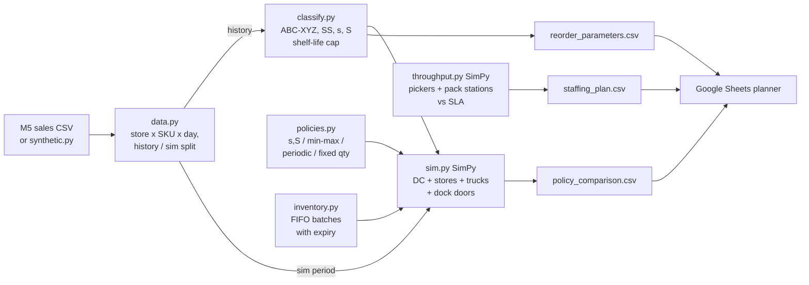

# DC-to-Store Replenishment & Capacity Simulator

**Python (SimPy, pandas), Google Sheets-ready planner exports**

A discrete-event simulation of one regional distribution centre (DC) replenishing a set of
quick-commerce dark stores that carry fresh, chilled and ambient groceries. It answers two
planning questions:

1. **Which replenishment policy, with which parameters?** Each store x SKU is classified
   **ABC-XYZ**, then gets a safety stock, reorder point (s) and order-up-to level (S).
   **(s, S)**, **min/max**, **periodic review** and a **fixed-quantity baseline** are compared
   on fill rate, perishable wastage, store stock and truck usage. Shelf life, FIFO issue,
   truck capacity and **DC loading-dock limits** are all modelled.
2. **How many pickers per hour?** A second SimPy model queues orders for pickers and pack
   stations and finds the smallest picker count that keeps 95% of orders inside the
   pick-and-pack SLA, for a normal day and a peak day.

Results are written as CSVs that load straight into Google Sheets for what-if planning
(new store, festival peak, changed lead time).

> **Status.** This is the working architecture. The pipeline and tests run end to end on
> synthetic M5-shaped demand (8 stores x 60 SKUs, 120 simulated days). In that run, (s, S)
> keeps a **99.5% fill rate** with about **31% less waste** than the fixed-quantity
> baseline. A 2-day periodic review starves fresh SKUs (about 71% fill) because their
> shelf-life cap leaves less than two days of cover. Results on the real M5 data are written
> to `reports/metrics.json` at run time.

## Architecture



### What happens in one simulated day

| Time | Event |
|---|---|
| 00:00 | DC reviews aggregate stock per SKU and orders from suppliers (2-day lead time) |
| 02:00 | Each store's policy places its order. The DC picks FIFO stock, cuts lines pro rata if a truck is full, and trucks queue for the loading docks |
| ~09:00 | Trucks arrive at stores. Batches keep the expiry date they had at the DC |
| 12:00 | Customer demand is served FIFO. Unmet demand is a lost sale |
| 23:30 | Expired batches are written off at the stores and at the DC |

## Setup

```bash
python -m venv .venv && source .venv/bin/activate   # Windows: .venv\Scripts\activate
pip install -r requirements.txt
pip install -e .
```

**Data.** Download `sales_train_evaluation.csv` from the Kaggle *M5 Forecasting - Accuracy*
competition into `data/raw/` (git-ignored). The FOODS departments are mapped to
fresh / chilled / ambient classes in `data.py`. M5 has no shelf-life data, so this mapping
is an assumption.

## How to run

```bash
# Real data: top 60 FOODS items across 8 M5 stores
python -m replenishment.pipeline --config configs/config.yaml

# Smoke run on synthetic demand
python -m replenishment.pipeline --synthetic --output-dir reports/synthetic_smoke

# Tests
pytest -q
```

Outputs under `--output-dir`:

| File | Use |
|---|---|
| `metrics.json` | per-policy results and the change against the fixed-quantity baseline |
| `planner/reorder_parameters.csv` | class, mean, std, safety stock, s, S per store x SKU |
| `planner/policy_comparison.csv` | fill rate, wastage, stock, trucks, dock wait per policy |
| `planner/staffing_plan.csv` | pickers needed per hour, normal vs peak day |

## Project structure

```
dc-replenishment-simulator/
├── configs/config.yaml        # network, shelf life, service levels, policies, throughput
├── data/raw/                  # M5 CSV (git-ignored)
├── src/replenishment/
│   ├── data.py                # M5 loader, history / simulation split
│   ├── synthetic.py           # negative-binomial demand with weekly cycle
│   ├── classify.py            # ABC-XYZ, safety stock, s and S with shelf-life cap
│   ├── inventory.py           # FIFO batch stock with expiry
│   ├── policies.py            # (s,S), min/max, periodic review, fixed quantity
│   ├── sim.py                 # SimPy DC -> store network
│   ├── throughput.py          # SimPy picker / pack-station model and staffing sweep
│   └── pipeline.py            # CLI entry point
└── tests/test_replenishment.py
```

## Modelling notes

- **Safety stock** is `z x sigma_daily x sqrt(L + R)`, where z comes from the service level of
  the SKU's ABC-XYZ class. AX items get 98% and CZ items get 90%.
- **Shelf-life cap.** S is capped at what can be sold in the shelf life left on arrival,
  allowing about a day at the DC first. Without the cap, high-service-level fresh SKUs are
  ordered beyond what can be sold and the waste shows up as expiry.
- **(s, S) vs min/max.** (s, S) reviews inventory position (on hand + on order). Min/max as
  stores usually run it reviews on-hand stock only and rounds up to supplier cases. With
  same-day delivery the pipeline rarely matters, so the gap comes mostly from case rounding
  on slow SKUs.
- **Dock and truck limits.** Trucks need a loading dock for `load_time_h`. When more stores
  are added, dock waits grow and later trucks land after the morning peak. That is the
  capacity question for a new store.
- **Picking model.** Task times are gamma-distributed with CV 0.5. Exponential times are
  much more variable than real picking and make any SLA unreachable. Calibrate pick and pack
  means and the shape parameter with a time-and-motion study.

## License

MIT © Mayank Sharma
